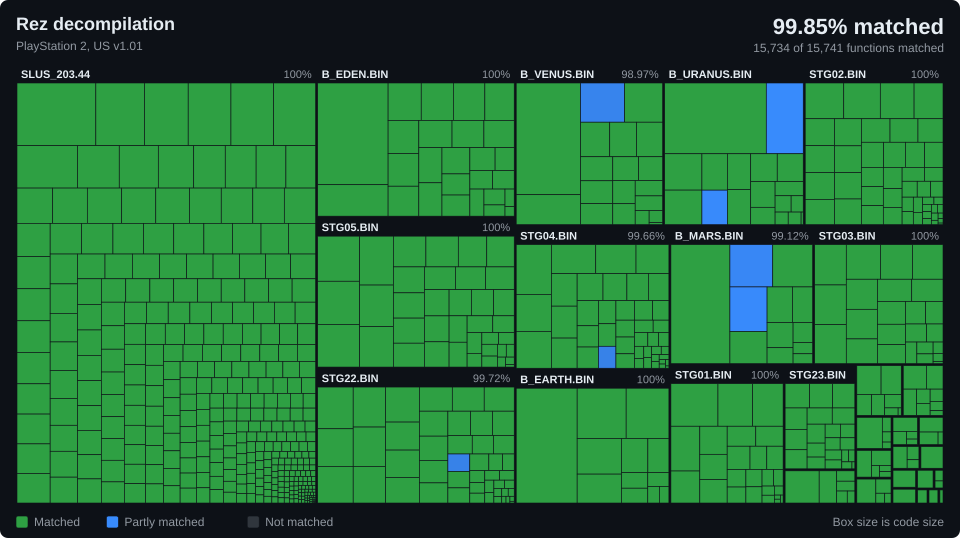

# Rez decompilation

A matching decompilation of Rez (United Game Artists / Sega, 2001) for the PlayStation 2. The
original compiler builds this source, and the linker joins it with the retail data. The result
matches the executable and its 29 code overlays byte for byte.

Note: 20-11-26 - Porting Rez as Kandinsky to PC has made me realised a lot of the code here is subpar to work with, I'll be backporting it to be better while maintaining matching! 

This repository holds no game code, data or assets. You need your own copy of the game to build
it.

I'm porting this source to other platforms as a project called Kandinsky. You're welcome to use it for anything else; I mention the port only to save you duplicate work. My plan is for it to use either PS2 or Dreamcast assets, just make it the best it can be on multiple platforms with a focus on performance. You can see my Super Mario Strikers port for a reference.

## Target

- Game: Rez, PlayStation 2, NTSC-U, version 1.01 (SLUS-20344)
- Executable: SLUS_203.44, sha256 d3e9c13fb065059f7baf19a45764221848e873cb6362e72d31e291658f1e6821
- Code overlays: 29 files in REZ.CVM
- Compiler: ee-gcc 2.9-ee-991111-01, -O2 -G0; -G8 for some units; another 2.9x build or the
  assembler for a few functions

## Status



The counts include the Sony, CRI and newlib code linked into the executable. Every function has
source, a name and its retail address.

## Building

You need Linux on x86-64 or WSL2 (or Docker), the i386 libraries, git, curl, make and Python
3.10+. You also need Rez (US, v1.01), as a disc image or as SLUS_203.44 and REZ.CVM.

```sh
sudo dpkg --add-architecture i386 && sudo apt update && sudo apt install libc6:i386 libstdc++6:i386
make setup                                   # pinned compiler and binutils, into .tools/
make extract DISC="/path/to/Rez (USA).cue"   # or EXE=.../SLUS_203.44 CVM=.../REZ.CVM
make build                                   # compile and link, a few minutes
make verify                                  # must print: 30/30 sha256 match
make disc                                    # optional: a playable copy of your disc image
```

Extract refuses any file whose hash differs from config/, so other regions and versions fail.
Build writes to build/relink/ps2-us-1.01/exact. Disc reads game/ps2-us-1.01/disc/*.bin and writes
build/disc/. In WSL, work on the Linux filesystem, because the compiler can't open files on a
mounted Windows drive.

On macOS or Windows, use Docker:

```sh
docker build --platform linux/amd64 -t rez .
docker run --rm --platform linux/amd64 -v "$PWD":/rez -v /path/to/your/files:/disc:ro rez \
    make setup extract build verify EXE=/disc/SLUS_203.44 CVM=/disc/REZ.CVM
```

[tools/README.md](tools/README.md) explains how the build works.

## FAQ

**Is it 100%?**\
Nearly. 7 of 15,741 functions don't compile to the original bytes yet. Each has working C that
behaves like the original in testing.

**What does matching mean?**\
The original compiler, with the original flags, turns each matched function into the retail
bytes. Linked together, the functions rebuild the executable and its overlays exactly.

**Can I play it?**\
Build it from your own copy (see Building), then run the result on a PS2 or in PCSX2.

**I bet this is another AI slop decomp.**\
It's a fair assumption; it's my first decomp. Every match is byte-exact, and I wrote the C for people to
read: named functions and globals, typed structs, no placeholder symbols.

**What's the point? We have Rez Infinite.**\
Rez Infinite and its ports are excellent. This keeps the original 2001 code and preserves it for generations to come.

**Why not the Dreamcast version? It's higher fidelity.**\
Dreamcast tools are immature: there's no matching splitter for the SH-4 and little diffing support. PS2
tools are mature, and I knew them better.

**Where do the names come from?**\
The game's own strings and debug menus, Sega's Ninja and Sony's library names where the code uses
them, and plain descriptive names elsewhere. The enemies surprised me: Area 1 is Egyptian (Khufu,
Menkaure, the Sphinx), Area 2 Hindu (Brahma, Shiva, Vishnu), Area 3 Mesopotamian (Gilgamesh,
Enkidu, Ishtar) and Area 5 the angelic choirs (Seraphim, Thrones, Dominions). Interestingly I don't believe the Area 5 level has any references to angels so it's a cool find.

## Layout

| Path | Contents |
|---|---|
| src/game, gw, nj, ps, ul | game code, the Gindows debug UI, Sega's Ninja library, the PS2 platform layers |
| src/cri, sce, libc | CRI ADX and ROFS, the Sony EE libraries, newlib, fdlibm and libgcc |
| src/asm | hand-written assembly |
| src/overlays | one folder per code overlay; common holds units that several overlays share |
| src/include | type headers and one header per main-executable unit |
| config | build records for each function, symbol maps, file hashes, toolchain pins |
| scripts, tools | the build |

## Conventions

Each original unit has one file, and each function sits under its retail address
(`/* 0x00af6700 */`). The source uses no inline assembly, embedded instruction words or #pragma.
A `/* steer(...) */` tag marks code that exists only to steer the compiler.

## Legal

Rez and related names belong to their owners. This project has no ties to, or endorsement from,
Sega, United Game Artists, Sony Interactive Entertainment or CRI Middleware. The source is an
independent rebuild. It includes no Sony SDK code: src/sce comes from the shipped executable, and
its headers declare only what the game uses.

## License

MIT, see [LICENSE](LICENSE). The license covers this source, not the game, its data or its names.
